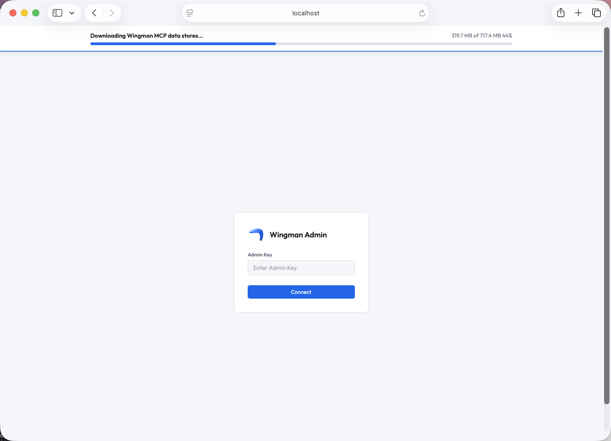
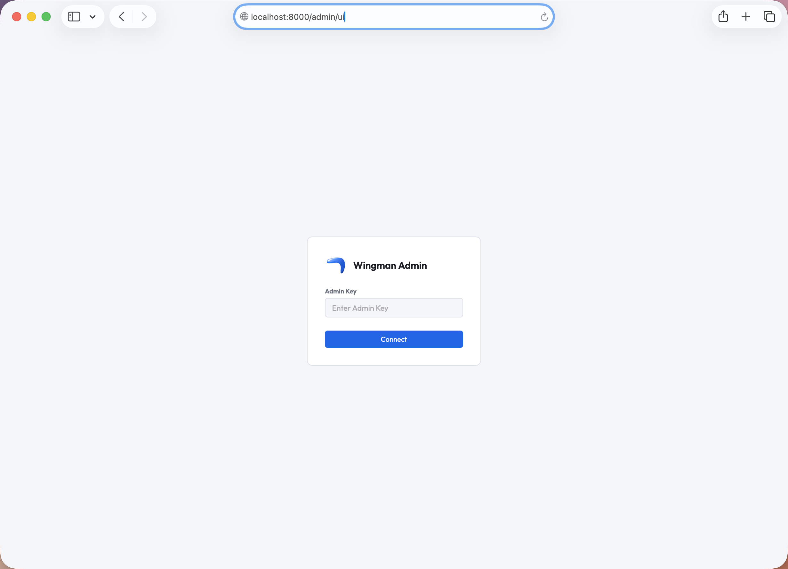
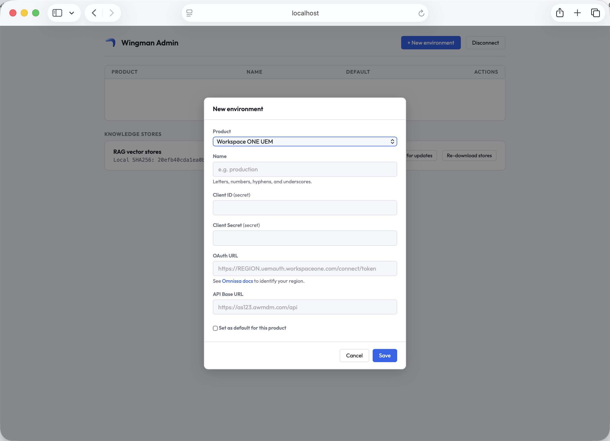
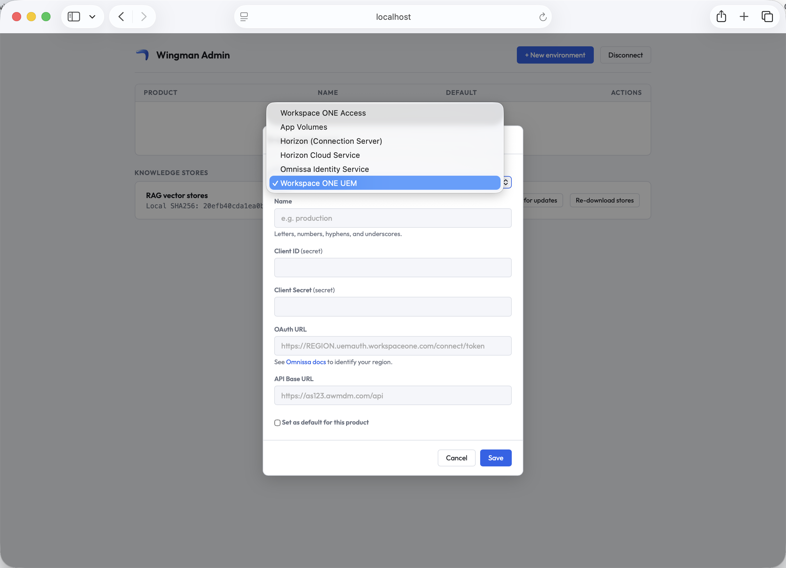

## 30th Oct 2026
### What's new
- **Sign in to the admin console with your identity provider (OIDC).** Works with Workspace ONE Access and other OIDC providers such as Keycloak. Settings are configured in the admin UI and stored encrypted. An optional callback relay supports providers that allow only one fixed redirect URI.
- **Access by group.** Choose which groups can open the admin console, and which groups get full or read-only MCP access. Saving MCP group rules requires a successful real-login "Test sign-in" first, to avoid locking yourself out.
- **Per-user API keys** for the self-host container.
- **Admin logout now ends the session on the server**, not just in the browser.
- **The admin store is kept across container restarts** when a volume is mounted.

### Improvements

- The admin page is reorganised into tabs, with a cleaner OIDC form and clearer sign-in status messages.
- The admin login page shows the provider's reason when a sign-in is refused.
- Admin users can be matched on any identity claim, with the email preferred.
- Admin UI polish: export and import of the environment store, selective import, and in-app dialogs.

### Fixes

- Fixed read-only and OAuth shim requests failing with a 500 error.
- Fixed a JavaScript error that broke the admin login page.
- Fixed a page-shift and stray-scrollbar issue on the admin page.
- Image security scan findings addressed.

<!-- source-sha:6ecef648c9982d1f7a428c7cb791ac40ac30929e -->

---------

# Wingman

> Your AI sidekick for Omnissa EUC.

Wingman gives AI assistants deep knowledge of Omnissa EUC products: documentation, REST API reference, release notes, and live access to your environments. Ask questions in natural language and get answers grounded in real docs and real data from your tenant.

## Two ways to run it

| | **wingman-mcp** | **Wingman container** |
|---|---|---|
| Best for | An individual on their own machine | A team or org running a shared server |
| Install | `pip install "wingman-mcp[rag]"` | `docker run ghcr.io/tbwfdu/wingman` |
| Transport | Local (stdio) | HTTP (Streamable-HTTP) |
| Credentials | Your own, via `wingman-mcp auth set` | Per-user headers, or shared admin environments |
| Access control | n/a (single user) | Full / read-only / admin access keys |

Both expose the same tools: offline documentation search plus live API tools across UEM, Horizon, App Volumes, Access, Identity Service, and Horizon Cloud.

# wingman-mcp

An [MCP server](https://modelcontextprotocol.io) that runs locally and exposes tools to any MCP-compatible AI client (Claude Code, Claude Desktop, Cursor, VS Code Copilot, Windsurf, Codex, and more).

**Documentation search:** instant, offline search across product docs, REST API reference, and release notes using local RAG. No API keys or network access required.

**Live API tools:** search devices, users, profiles, apps, smart groups, and organization groups across UEM, Horizon, App Volumes, Access, Identity Service, and Horizon Cloud. Authenticate once with `wingman-mcp auth set` and your AI assistant can query your tenant directly.

See [wingman-mcp/README.md](wingman-mcp/README.md) for setup instructions and the full tool list.

### Quick start

```bash
pip install "wingman-mcp[rag]"
wingman-mcp status
wingman-mcp auth set   # optional: connect to your environment for live API tools
```

Then add `wingman-mcp serve` to your MCP client of choice. See [wingman-mcp/README.md](wingman-mcp/README.md) for client-specific configuration.

<br> <br>

# Wingman Container

A single container that serves Wingman over HTTP, so a whole team can share one
deployment instead of each person installing the package. No Azure, no Entra, no
API keys; you bring one or more access keys and run the image. On first boot the
documentation, REST API reference, and release-notes RAG stores (~1.6 GB) are
downloaded from a public GitHub Release into `/data/stores`; mount a volume there
and the download happens only once.

- **Multi-user:** hand out full, read-only, and admin access keys, presented in
  the `X-Wingman-Access-Key` header. Read-only callers are blocked from any tool
  that changes an environment or bulk-exports data.
- **Per-user credentials:** each user supplies their own product credentials as
  request headers, scoped to the request and never stored.
- **Shared environments (admin API):** an admin configures product
  environments once (encrypted at rest) and every user shares them.
- **Custom knowledge stores:** turn your own content (a wiki, runbooks, a folder
  of PDFs) into a searchable store, upload it in the admin UI, and assistants get
  a search tool for it. See [Custom knowledge stores](#custom-knowledge-stores).

### First run

Generate all three access keys and write them to an env file:

```bash
{
  echo "WINGMAN_MCP_ACCESS_KEY=$(openssl rand -hex 32)"
  echo "WINGMAN_MCP_READONLY_ACCESS_KEY=$(openssl rand -hex 32)"
  echo "WINGMAN_MCP_ADMIN_KEY=$(openssl rand -hex 32)"
  echo "WINGMAN_MCP_ENCRYPTION_KEY=$(openssl rand -hex 32)"
} > wingman.env
chmod 600 wingman.env
```

> **Keep `wingman.env` safe.** It contains all your access keys and the encryption
> key for the admin store. Restrict its permissions (`chmod 600`), do not commit it
> to version control, and do not delete it: you will need it every time you restart
> or update the container, and the keys cannot be recovered if lost. If you are
> working in a git repository, add `wingman.env` to your `.gitignore`.

Then start the container:

```bash
docker run -d --name wingman -p 8000:8000 \
  --env-file wingman.env -v wingman-stores:/data/stores \
  ghcr.io/tbwfdu/wingman:latest

# Watch the one-time store download on first boot
docker logs -f wingman

# Once it's up:
curl localhost:8000/health   # -> ok
```

The `-v wingman-stores:/data/stores` named volume caches the RAG stores so later starts are instant.

If you manage secrets in an external credentials store, you can pass the keys directly as `-e` flags instead of using an env file:

```bash
docker run -d --name wingman -p 8000:8000 \
  -e WINGMAN_MCP_ACCESS_KEY=<full-key> \
  -e WINGMAN_MCP_READONLY_ACCESS_KEY=<readonly-key> \
  -e WINGMAN_MCP_ADMIN_KEY=<admin-key> \
  -e WINGMAN_MCP_ENCRYPTION_KEY=<encryption-key> \
  -v wingman-stores:/data/stores \
  ghcr.io/tbwfdu/wingman:latest
```

### Environment variables

| Env var | Required | Purpose |
|---|---|---|
| `WINGMAN_MCP_ACCESS_KEY` | Yes\* | Full-access key, presented via the `X-Wingman-Access-Key` header. |
| `WINGMAN_MCP_READONLY_ACCESS_KEY` | No | Read-only key (same header); can call only non-mutating tools. |
| `WINGMAN_MCP_ADMIN_KEY` | No | Enables the `/admin` API for shared environments. |
| `WINGMAN_MCP_ENCRYPTION_KEY` | If admin key set | Encrypts the admin store at rest. The admin API won't start without it. |
| `WINGMAN_MCP_ADMIN_STORE_PATH` | No | Path to the encrypted admin store. Default `~/.wingman-mcp/admin/environments.enc`; point at a mounted volume to persist. |
| `WINGMAN_MCP_ALLOW_ENV_SELECTION` | No | Lets a tool call target any admin environment via its `env` argument. On by default when the admin key is set. Set to `0` or `false` to disable. |
| `WINGMAN_MCP_EXTRA_MUTATING_TOOLS` | No | Comma-separated tool names to additionally treat as mutating (forward-compat for tools added after this image was built). |
| `WINGMAN_MCP_PUBLIC_URL` | No | Canonical URL advertised in discovery docs when behind a proxy / custom domain. |
| `WINGMAN_MCP_DATA_DIR` | No | Where the RAG stores live. Defaults to `/data/stores` in the image; mount a volume here to cache them across restarts. |
| `WINGMAN_MCP_CUSTOM_STORES_DIR` | No | Where uploaded custom knowledge stores are kept. Defaults to `custom-stores/` inside the stores volume. |
| `WINGMAN_MCP_CUSTOM_STORE_MAX_UPLOAD_MB` | No | Largest archive the admin UI accepts. Default 1024. |

\* At least one of `WINGMAN_MCP_ACCESS_KEY` or `WINGMAN_MCP_READONLY_ACCESS_KEY`
must be set, or the server refuses to start.

### Access tiers

Hand out different keys for different levels of access. All are optional and independent; set only the ones you need. A caller presents exactly one key.

| Tier | Env var | Header | Can do |
|---|---|---|---|
| **Full** | `WINGMAN_MCP_ACCESS_KEY` | `X-Wingman-Access-Key` | Any tool, including ones that change the environment. |
| **Read-only** | `WINGMAN_MCP_READONLY_ACCESS_KEY` | `X-Wingman-Access-Key` | Non-mutating tools only. |
| **Admin** | `WINGMAN_MCP_ADMIN_KEY` | `X-Wingman-Admin-Key` | Manage shared environments via the `/admin` API. |

Full and read-only share the `X-Wingman-Access-Key` header; the server tells them apart by value.

### Connect an MCP client

Point any Streamable-HTTP MCP client at the server and send your key in the
`X-Wingman-Access-Key` header:

```json
{
  "mcpServers": {
    "wingman": {
      "type": "http",
      "url": "http://localhost:8000/mcp",
      "headers": { "X-Wingman-Access-Key": "<your-access-key>" }
    }
  }
}
```

The documentation-search tools work immediately; the live API tools activate once
credentials are available, either per-user via `X-*` headers or from a shared admin environment.

### Shared environments (admin API)

An admin can configure product credentials once and have every user share them,
so no per-user credential headers are needed. Enable it by adding to your env file:

```
WINGMAN_MCP_ADMIN_KEY=<your-admin-key>
WINGMAN_MCP_ENCRYPTION_KEY=<32-byte-hex-key>
```

Mount a volume at `WINGMAN_MCP_ADMIN_STORE_PATH` so the encrypted store survives restarts.

> ⚠️ Shared environments are a **service-account model**: every holder of a user
> access key acts against the configured tenants. Pair it with the read-only key
> for users who should not make changes, and scope the product credentials accordingly.

#### Admin UI

When the admin key is configured, a browser-based UI is available at `http://<host>:8000/admin/ui`.

**First boot:** The server downloads the knowledge stores (~700 MB) on first start. The UI shows a live progress banner while this completes.



Authenticate with your admin key:



Click **+ New environment**, choose a product, give it a name, fill in the credentials, and save. The first environment created for each product automatically becomes its default.



Supported products: Workspace ONE UEM, App Volumes, Horizon (Connection Server), Horizon Cloud Service, Omnissa Identity Service, and Workspace ONE Access.



From the main table you can edit credentials, switch the default, or delete environments. The **Knowledge stores** tab shows the local SHA256 of the downloaded stores and lets you check for updates or re-download. It is also where you upload your own stores; see [Custom knowledge stores](#custom-knowledge-stores).

#### Via the REST API

```bash
ADMIN=<your-admin-key>
BASE=http://localhost:8000
```

**Create an environment** (the first one per product becomes the default automatically):

```bash
# Workspace ONE UEM
curl -s -X POST $BASE/admin/environments \
  -H "X-Wingman-Admin-Key: $ADMIN" -H "Content-Type: application/json" \
  -d '{"product":"uem","name":"prod","credentials":{
        "client_id":"your-client-id","client_secret":"your-client-secret",
        "token_url":"https://REGION.uemauth.workspaceone.com/connect/token",
        "api_base_url":"https://as123.awmdm.com"}}' | jq .

# Horizon (Connection Server)
curl -s -X POST $BASE/admin/environments \
  -H "X-Wingman-Admin-Key: $ADMIN" -H "Content-Type: application/json" \
  -d '{"product":"horizon","name":"prod","credentials":{
        "username":"svc-wingman","password":"your-password",
        "server_url":"https://connectionserver.example.com","domain":"CORP"}}' | jq .

# Horizon Cloud Service
curl -s -X POST $BASE/admin/environments \
  -H "X-Wingman-Admin-Key: $ADMIN" -H "Content-Type: application/json" \
  -d '{"product":"horizon_cloud","name":"prod","credentials":{
        "client_id":"your-client-id","client_secret":"your-client-secret",
        "api_base_url":"https://cloud.horizon.omnissa.com","org_id":"your-org-id"}}' | jq .

# App Volumes
curl -s -X POST $BASE/admin/environments \
  -H "X-Wingman-Admin-Key: $ADMIN" -H "Content-Type: application/json" \
  -d '{"product":"app_volumes","name":"prod","credentials":{
        "username":"svc-wingman","password":"your-password",
        "manager_url":"https://appvolumes.example.com"}}' | jq .

# Workspace ONE Access
curl -s -X POST $BASE/admin/environments \
  -H "X-Wingman-Admin-Key: $ADMIN" -H "Content-Type: application/json" \
  -d '{"product":"access","name":"prod","credentials":{
        "client_id":"your-client-id","client_secret":"your-client-secret",
        "tenant_url":"https://TENANT.us0.wss.workspaceone.com",
        "token_url":"https://TENANT.us0.wss.workspaceone.com/SAAS/auth/oauthtoken"}}' | jq .

# Omnissa Identity Service
curl -s -X POST $BASE/admin/environments \
  -H "X-Wingman-Admin-Key: $ADMIN" -H "Content-Type: application/json" \
  -d '{"product":"identity_service","name":"prod","credentials":{
        "client_id":"your-client-id","client_secret":"your-client-secret",
        "tenant_url":"https://your-identity-service-host",
        "token_url":"https://your-identity-service-host/acs/token"}}' | jq .
```

Credential fields per product:

| Product | `product` | Required fields |
|---|---|---|
| Workspace ONE UEM | `uem` | `client_id`, `client_secret`, `token_url`, `api_base_url` |
| Horizon | `horizon` | `username`, `password`, `server_url`, `domain` |
| Horizon Cloud | `horizon_cloud` | `client_id`, `client_secret`, `api_base_url`, `org_id` |
| App Volumes | `app_volumes` | `username`, `password`, `manager_url` |
| Workspace ONE Access | `access` | `client_id`, `client_secret`, `tenant_url`, `token_url` |
| Identity Service | `identity_service` | `client_id`, `client_secret`, `tenant_url`, `token_url` |

**Inspect, update, delete:**

```bash
# List all environments (secrets masked)
curl -s -H "X-Wingman-Admin-Key: $ADMIN" $BASE/admin/environments | jq .

# Rotate credentials
curl -s -X PUT $BASE/admin/environments/uem/prod \
  -H "X-Wingman-Admin-Key: $ADMIN" -H "Content-Type: application/json" \
  -d '{"credentials":{"client_id":"abc123","client_secret":"new-secret",
        "token_url":"https://REGION.uemauth.workspaceone.com/connect/token",
        "api_base_url":"https://as123.awmdm.com"}}' | jq .

# Promote to default
curl -s -X POST $BASE/admin/environments/uem/dev/default \
  -H "X-Wingman-Admin-Key: $ADMIN" | jq .

# Delete (204 No Content; another environment is promoted to default automatically)
curl -s -o /dev/null -w '%{http_code}\n' -X DELETE \
  -H "X-Wingman-Admin-Key: $ADMIN" $BASE/admin/environments/uem/dev
```

**How users consume them:** for any product a user does not send headers for, the server injects the admin store's default environment. Users can target a non-default environment with the `X-Wingman-Environment: <name>` header. Their own credential headers always take precedence.

### Custom knowledge stores

Add your own content as extra knowledge stores: a team wiki, product runbooks, a folder of PDFs. Each store appears to assistants as its own search tool, `search_kb_<name>`, alongside the built-in documentation search.

Two roles are involved, and one person can do both:

- **The author** prepares the content and builds the store on their own machine. The result is a single zip file.
- **The admin** (whoever holds the admin key) uploads the zip in the admin UI.

You need a Wingman image that includes custom stores. If your admin UI has a **Custom knowledge stores** card on the **Knowledge stores** tab, it does.

#### 1. Prepare the content

Put everything in one folder. Sub-folders are read.

| Content | Files read | Notes |
|---|---|---|
| Markdown | `.md`, `.markdown` | Best results. Split by headings, so each section is found on its own. |
| Text | `.txt`, `.rst` | One document per file. |
| HTML | `.html`, `.htm` | Converted to Markdown first. Scripts, menus and images are dropped. |
| PDF | `.pdf` | Text only. A scanned PDF with no text layer yields nothing, so run OCR first. |
| Confluence Cloud | Page or folder URLs | Read with your own API token. See below. |

Word, PowerPoint and Excel files are not read. Save them as PDF or Markdown first. Hidden files and images are skipped, and the next step tells you exactly what it read and what it ignored.

Before you build, check the content:

- **Everyone who can use the server can read everything in the store.** Permissions from the source (for example Confluence page permissions) do not carry over. Only include content that suits that whole audience.
- **Remove drafts and anything pending.** Pages marked "draft", "items for review" or "pending correction" will be searched and quoted like the rest.
- **Keep secrets out.** The build and the upload both refuse a store whose text contains keys, tokens or card numbers.
- **Give each page a clear title and headings.** Results are labelled with the page title and heading path, and that is what lets an assistant tell similar sections apart.
- **Keep internal content out of source control.** The built store is a copy of your content.

For Confluence, create a standard API token (a scoped token may be rejected) and have your Atlassian email and the token ready. Prefer listing the specific pages you want over pointing at a whole space, so work in progress is not swept in later.

#### 2. Create the store

The authoring tool is the `wingman` command inside the container image. Run it once, interactively, on any machine with Docker. This mounts your content folder (read-only) and an output folder, and skips the server's first-boot download:

```bash
docker run --rm -it --entrypoint wingman \
  -v "$PWD/my-docs:/input:ro" -v "$PWD/my-stores:/out" \
  ghcr.io/tbwfdu/wingman:latest \
  stores create --source-dir /input --work-dir /out
```

It asks a few questions. Press Enter to accept the answer in brackets.

1. **Content source.** A folder of files, or Confluence URLs.
2. **Name and short name.** The short name becomes the tool name (`search_kb_<short-name>`).
3. **What it covers.** One or two sentences. Assistants read this to decide when to search the store, so be specific.
4. **Owner, and who may see it.** The owner is the person to ask about wrong or stale content. Choose `internal` unless the content is approved for public sharing.
5. **Up to three example questions** (optional). It prints the best match for each, so you can see the store answers something.
6. **Where to save the zip.**

It then shows a summary, builds the store (the language model it needs is already in the image), checks it, and writes `<short-name>.zip` into your output folder.

For Confluence, replace the folder option with page URLs, and pass your credentials through from your shell so they are not typed on the command line (or leave them out and it will ask, hiding the token):

```bash
docker run --rm -it --entrypoint wingman \
  -e CONFLUENCE_EMAIL -e CONFLUENCE_API_TOKEN \
  -v "$PWD/my-stores:/out" \
  ghcr.io/tbwfdu/wingman:latest \
  stores create --confluence https://example.atlassian.net/wiki/spaces/ENG/pages/123456/Runbook --work-dir /out
```

Add `--with-children` to include the pages beneath each one you list. Credentials are used for that run only and are never written to the store or the zip.

Every question also has a flag, so the command can run without prompts, for a script:

```bash
docker run --rm --entrypoint wingman \
  -v "$PWD/my-docs:/input:ro" -v "$PWD/my-stores:/out" \
  ghcr.io/tbwfdu/wingman:latest \
  stores create --source-dir /input --work-dir /out --name "Acme Widgets" \
  --description "Setup and resets for Acme widgets." --owner you@example.com \
  --classification internal --question "how do I reset a widget" --yes
```

To change the content later, run the same command again with the same short name. It asks before replacing the old build and raises the version number, so the admin can see which copy is newer.

#### 3. Upload it in the admin UI

1. Open `http://<host>:8000/admin/ui` and sign in with the admin key.
2. Go to the **Knowledge stores** tab.
3. On the **Custom knowledge stores** card, choose **Import stores** and pick the zip.

The upload is checked before anything is installed. If any store in the zip fails, nothing is imported and a dialog lists each problem. If a store with the same short name is already there, you are asked before it is replaced (the dialog shows the old and new versions, and replacing cannot be undone). When it succeeds, the store appears as a row showing its name, short name, version, who may see it, size, import date and owner, with a **Remove** button.

Stores are kept in `custom-stores/` inside the stores volume, so they survive restarts and container replacement. If the card warns that the folder is not on a mounted volume, mount one at `/data/stores` as in [First run](#first-run), or imported stores are lost when the container is replaced. Archives up to 1024 MB are accepted by default (see `WINGMAN_MCP_CUSTOM_STORE_MAX_UPLOAD_MB`).

Only import zips from someone you trust. Importing loads the store's database into the server, and its text is later shown to assistants as reference material.

#### 4. Use it

Nothing to restart. The tool list is read when a client asks for it, so reconnect your MCP client (or start a new session) and the new `search_kb_<short-name>` tool appears. Then ask a question the store covers. Assistants pick the tool from the description you wrote, so a specific description and good example questions decide whether the right store is chosen.

Things to know:

- **Labels are guidance, not access control.** A store marked `internal` makes results carry an `[INTERNAL]` tag, and the server asks assistants to open answers with **INTERNAL ONLY** and name the source. Assistants can ignore that, and it does not stop anyone with a key from searching the store.
- **Read-only keys can search custom stores.** The tools only read.
- **Search always returns its closest matches,** even for a question the store cannot answer. Check the sources quoted in the answer.
- **Keep the number of stores modest.** Each one adds a tool to every client's list. A handful is fine; dozens make it hard for an assistant to choose.
- **Rebuild when the content changes.** A store is a snapshot of the moment it was built. For Confluence content, rebuild on a schedule.

### Updating

```bash
docker pull ghcr.io/tbwfdu/wingman:latest
docker rm -f wingman && docker run -d --name wingman -p 8000:8000 \
  --env-file wingman.env -v wingman-stores:/data/stores \
  ghcr.io/tbwfdu/wingman:latest
```

## Release notes

What changed in the latest container image. Earlier versions are on the [Releases page](https://github.com/tbwfdu/wingman/releases).

<!-- release-notes:start -->
**latest-20261101-d79e53b**

- Add OIDC setup wizard with provider chooser and field help; document Workspace ONE Access setup
- Polish the Knowledge Stores Status dialog
- Publish changelog.json alongside the stores archive
- Disable the environments Export button when there is nothing to export
- Widen the stores status dialog so the full SHA256 fits
- Show change dates in the Knowledge Stores Status dialog
- Ingest the new docs.omnissa.com /<bundle>/<page> URLs
<!-- release-notes:end -->

## License

See [LICENSE](LICENSE) for details.
